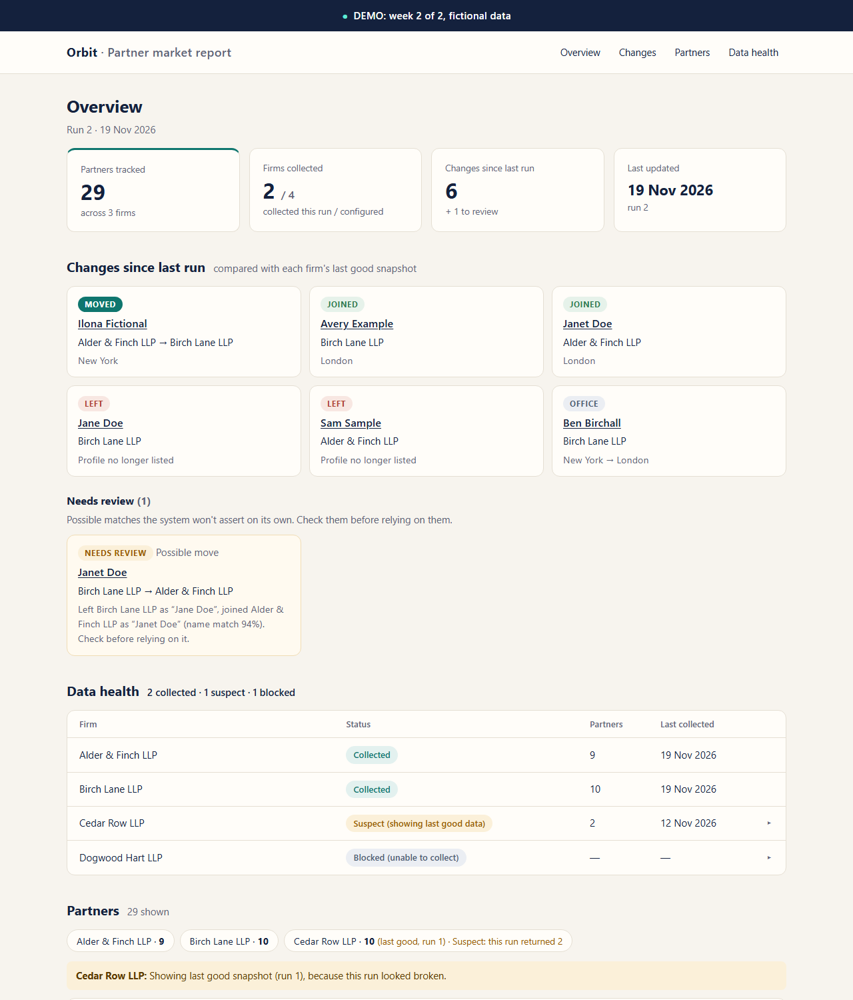

# Orbit

Tracks Corporate/M&A partners at top law firms each week and reports who joined, left, or moved between firms.



## Quick start

Requires Python 3.12.

```bash
git clone https://github.com/adamazmy/Orbit.git
cd Orbit
python -m venv .venv
.venv\Scripts\activate          # Windows; on macOS/Linux: source .venv/bin/activate
pip install -e ".[dev]"
```

```bash
orbit run            # fetch every enabled firm, store a snapshot, write reports/latest.html
orbit demo           # build reports/demo.html from fictional data (no network)
orbit report         # re-render reports/latest.html from the database (no network)
python -m pytest     # 116 tests, all offline
```

The first live `orbit run` records a baseline: there is nothing to compare it with yet, so changes appear from the second run onward. Real partner lists change slowly, so `orbit demo` plays two fictional weeks through the same pipeline to show what joins, departures, moves and review flags look like in the report. The demo uses a temporary database and never touches `data/orbit.db`.

Data is stored in `data/orbit.db` (SQLite) and raw responses are cached in `data/raw/<run_id>/<firm_id>/`. Both are local only and gitignored.

## What I built, who it's for, and why

TODO: Adam writes this. Facts you can use:
- Built for recruiters at Pinpoint Partners, to follow partner moves in Corporate/M&A without checking firm websites by hand.
- The output is one self-contained HTML file (inline CSS and JS, no CDN), so it opens offline and can be emailed.
- The report shows this week's changes (moves first), a "Needs review" list for matches the system won't assert on its own, a firm health table, and a searchable, filterable table of every tracked partner.
- Scope rule from RECON.md: people titled Partner in M&A, Private Equity or M&A sub-practices.
- Designed to run weekly: each run is an append-only snapshot, and changes come from comparing snapshots.

## Coverage and accuracy

15 firms are listed in [`config/firms.yaml`](config/firms.yaml). Two are collected; the rest are blocked, out of scope or not yet assessed. Counts are from run 12 (19 Nov 2026). Recon details per firm are in [RECON.md](RECON.md).

| Firm | Status | Partners (run 12) | Expected (recon) | Reason / notes |
|---|---|---|---|---|
| Cravath, Swaine & Moore | ACTIVE | 65 | 65 | JSON search endpoint. Cravath has no M&A sub-practice, so "Corporate" is used: it also includes capital markets and finance partners (known over-inclusion). |
| Weil, Gotshal & Manges | ACTIVE | 92 | 92 | JSON listing endpoint returning HTML snippets. M&A (51) + Private Equity (79), 38 in both. |
| Wachtell, Lipton, Rosen & Katz | BLOCKED | — | 35 | Cloudflare bot challenge on `/attorneys` (403, `Cf-Mitigated: challenge`) although robots.txt allows it. Not bypassed. Evidence: [docs/evidence/wachtell-cloudflare.txt](docs/evidence/wachtell-cloudflare.txt) |
| Davis Polk & Wardwell | BLOCKED | — | 80 | The site's edge (Pantheon) returns 403 to Orbit's HTTP client even with headers identical to curl, which gets 200. Treated as TLS fingerprinting. Not bypassed. Evidence: [docs/evidence/davispolk-curl-200.txt](docs/evidence/davispolk-curl-200.txt) |
| Simpson Thacher & Bartlett | BLOCKED | — | — | The directory API (`/dataservices`) is disallowed by robots.txt, and the allowed sitemap is stale (every entry dated 2021). See [RECON.md §4](RECON.md#4-simpson-thacher--bartlett--blocked-document-dont-build). |
| Quinn Emanuel Urquhart & Sullivan | OUT OF SCOPE | — | — | Litigation-only firm: M&A litigation, no transactional M&A practice. |
| Kirkland & Ellis | NOT ASSESSED | — | — | Not yet assessed. |
| Latham & Watkins | NOT ASSESSED | — | — | Not yet assessed. |
| Skadden, Arps, Slate, Meagher & Flom | NOT ASSESSED | — | — | Not yet assessed. |
| Gibson, Dunn & Crutcher | NOT ASSESSED | — | — | Not yet assessed. |
| Paul Hastings | NOT ASSESSED | — | — | Not yet assessed. |
| King & Spalding | NOT ASSESSED | — | — | Not yet assessed. |
| Paul, Weiss, Rifkind, Wharton & Garrison | NOT ASSESSED | — | — | Not yet assessed. |
| Milbank | NOT ASSESSED | — | — | Not yet assessed. |
| Sullivan & Cromwell | NOT ASSESSED | — | — | Not yet assessed. |

How accuracy is protected:
- **Completeness checks in each adapter.** Cravath's adapter pages until it has the `total` the API reports. Weil's must end with exactly `TotalCount` unique profiles. Otherwise the firm is marked FAILED, not stored as a short list.
- **Health check.** A firm with 0 partners, or a drop of more than 30% against its last OK run, is marked SUSPECT and produces no change events that run. The report then shows its last good list, labelled as such.
- **Diffs against the last OK run**, not simply the previous run, so one bad run doesn't create false joins and departures.
- **Cross-firm moves.** A move is only asserted automatically when the names score 92 or more and the normalised first and last names are identical. Weaker matches (85 or more) are shown under "Needs review", and the underlying LEFT and JOINED are kept.
- **Real-world checks** against known facts are in [RECON.md](RECON.md#real-world-validation).

Known limitation: matching is by name, so a partner whose name changes as they move shows as a separate LEFT and JOINED, not a move.

## Architecture and key decisions

```
config/firms.yaml          firms, URLs and IDs, status (ACTIVE / BLOCKED / ...)
      |
      v
fetch.py   Fetcher         robots.txt check, identifying User-Agent, >=2s per domain,
      |                    timeouts, retries, raw cache in data/raw/
      v
adapters/<firm>.py         fetch and parse only -> list[PartnerRecord]
      |
      v
normalise.py               keep partners only; normalised name for matching
      |
      v
health.py                  OK, or SUSPECT (0 partners / >30% drop vs last OK run)
      |
      v
store.py   SQLite          append-only snapshot per firm per run
      |
      v
diff.py                    each OK firm vs its last OK snapshot:
      |                    JOINED, LEFT, OFFICE/TITLE_CHANGED, MOVED,
      |                    plus review flags (POSSIBLE_MOVE, LISTED_AT_TWO_FIRMS)
      v
report.py + template       reports/latest.html (self-contained)
```

Key decisions:
- **Adapters only fetch and parse.** Normalising, health checks, storage, diffing and reporting are shared, so adding a firm means one config entry, one adapter file, one registry line and one fixture test. Checklist: [docs/CODE_GUIDE.md › How to add a firm](docs/CODE_GUIDE.md#how-to-add-a-firm).
- **Firm-specific values live in config**, not in code (URLs, practice and position IDs, office mappings).
- **Every request goes through one fetcher**, so the scraping rules are enforced in one place.
- **A firm that fails never stops the others.** Each firm is stored and committed on its own, and a failure is recorded as BLOCKED or FAILED with the reason.
- **Append-only history.** Every run adds a snapshot; nothing is overwritten. Change detection is a comparison of snapshots.
- **Doubt is shown, not hidden.** Uncertain matches are flagged for review, never asserted.

A file-by-file walkthrough is in [docs/CODE_GUIDE.md](docs/CODE_GUIDE.md).

## What I deliberately left out

TODO: Adam writes this. Facts you can use:
- No browser automation: Playwright is an approved dependency but isn't installed, because no collected firm needs it. Blocked firms stay blocked rather than being scraped through a headless browser or TLS impersonation.
- 9 firms are listed as NOT ASSESSED in config; Simpson Thacher's stale 2021 sitemap was not used as a fallback (it misses recent hires).
- No contact data: emails, phone numbers, photos and bios are never read, though some responses contain them.
- Name changes during a move aren't matched (would need another identifier, e.g. a bar number, which isn't collected).
- No web server, scheduler, ORM or Docker: it's a CLI that writes a static file. <!-- add signals / notifications here depending on what gets built -->

## How it holds up as it grows, and what I'd change first

TODO: Adam writes this. Facts you can use:
- Adding a firm touches four places only (config, adapter, registry line, fixture test); nothing shared changes.
- The fetcher waits 2s per domain and tracks delays per domain, and firms are fetched one after another; one run of two firms makes a handful of requests.
- `observations` grows by one full snapshot per firm per run (append-only), with an index on `(run_id, firm_id)` because every diff reads that way.
- Raw responses are cached per run in `data/raw/`; there's no retention or clean-up yet.
- Cross-week move matching looks back 28 days (`MATCH_WINDOW_DAYS`), because firms update their sites at different speeds.

## Responsible scraping and data protection

TODO: Adam writes this. Facts you can use:
- Every request checks robots.txt first; a 401/403 on robots.txt is treated as "keep out". Requests carry an identifying User-Agent with a link to this repo: `OrbitBot/0.1 (partner-market research; weekly; +https://github.com/adamazmy/Orbit)`.
- At least 2 seconds between requests to the same site, timeouts, and at most 3 retries.
- Bot protection is never bypassed: Wachtell (Cloudflare) and Davis Polk (TLS fingerprinting) were marked BLOCKED with evidence, and Simpson Thacher's robots.txt-disallowed API wasn't used.
- Only name, title, practices, offices and profile URL are stored. The raw cache can contain whole responses (e.g. emails in Cravath's JSON), so `data/` is gitignored and stays local; API keys in logged URLs are redacted.
- Test fixtures use fictional people with no emails or phone numbers.

## Tech stack and why

- **Python 3.12**: simple to read and run; the whole tool is plain functions.
- **httpx**: HTTP client with timeouts and a clean API, wrapped by the polite fetcher.
- **selectolax** (lexbor parser): fast HTML parsing for Weil's HTML snippets.
- **rapidfuzz**: fuzzy name scoring (`token_set_ratio`) for cross-firm move matching.
- **pydantic**: validates `firms.yaml` and the partner/event models at the boundary.
- **pyyaml**: reads the firm config.
- **typer**: the `orbit` command-line interface.
- **jinja2**: renders the HTML report, with autoescaping on (names come from websites).
- **sqlite3** (standard library): one-file database, no server, no ORM.
- **pytest**: offline tests against fictional fixtures.

## How this feeds Future Recruiter AI

TODO: Adam writes this. Facts you can use:
- Every change is stored as a structured event (type, name, from/to firm, details, confidence, needs_review) in SQLite, not only as report text.
- Snapshots are append-only, so there's a full weekly history of who was where.
- Each partner has a stable per-firm ID (`person_key`) and profile URL, which can link Orbit's records to other data.
- Uncertainty is explicit (`confidence`, `needs_review`), so downstream tools can treat asserted moves and possible moves differently.

## Time spent and AI use

TODO: Adam writes this. Facts you can use:
- First commit 18 Nov 2026 19:18; recon done by hand on 18 Nov (RECON.md); the build ran into 19 Nov. 31 commits so far.
- Built with Claude Code, working from PLAN.md and the rules in [CLAUDE.md](CLAUDE.md) (small steps, commit only after review, tests before code commits, no bypassing bot protection).
- Real data in test fixtures was replaced with fictional people before committing.
- 116 tests, all offline.
