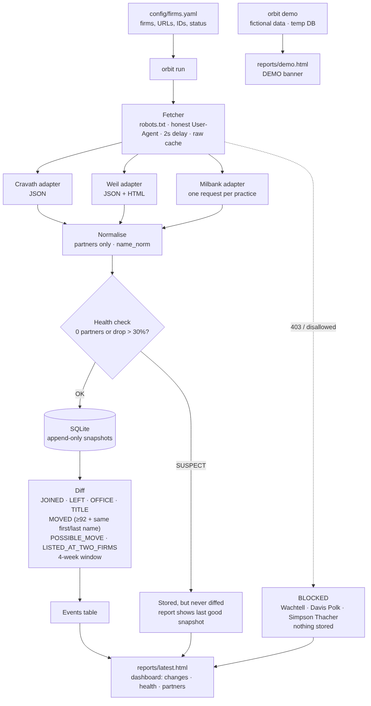

# Orbit

Tracks Corporate/M&A partners at top law firms each week and reports who joined, left, or moved between firms.

**▶ [Watch the video walkthrough on Loom](https://www.loom.com/share/9707a2e6cddc429c92057370ed53d1b7?t=0)**


## Contents

1. [Quick start](#quick-start)
2. [What I built, who it's for, and why](#what-i-built-who-its-for-and-why)
3. [Coverage and accuracy](#coverage-and-accuracy)
4. [Architecture and key decisions](#architecture-and-key-decisions)
5. [What I deliberately left out](#what-i-deliberately-left-out)
6. [How it holds up as it grows, and what I'd change first](#how-it-holds-up-as-it-grows-and-what-id-change-first)
7. [Responsible scraping and data protection](#responsible-scraping-and-data-protection)
8. [Tech stack and why](#tech-stack-and-why)
9. [How this feeds Future Recruiter AI](#how-this-feeds-future-recruiter-ai)
10. [Time spent and AI use](#time-spent-and-ai-use)

For how the code works file by file, see [docs/CODE_GUIDE.md](docs/CODE_GUIDE.md). Per-firm recon notes are in [RECON.md](RECON.md).

## Quick start

Requires Python 3.12.

```bash
git clone https://github.com/adamazmy/Orbit.git
cd Orbit
python -m venv .venv
.venv\Scripts\activate          # Windows; on macOS/Linux: source .venv/bin/activate
pip install -e ".[dev]"
```

```bash
orbit run            # fetch every enabled firm, store a snapshot, write reports/latest.html
orbit demo           # build reports/demo-week1.html and demo-week2.html from fictional data (no network)
orbit report         # re-render reports/latest.html from the database (no network)
python -m pytest     # 137 tests, all offline
```

The first live `orbit run` records a baseline: there is nothing to compare it with yet, so changes appear from the second run onward. Real partner lists change slowly, so `orbit demo` plays two fictional weeks through the same pipeline and writes a report after each one: `demo-week1.html` shows the baseline (nothing to compare yet), and `demo-week2.html` shows what joins, departures, moves, review flags and a suspect firm look like a week later. Each carries a banner saying which week it is. The demo uses a temporary database and never touches `data/orbit.db`.

Data is stored in `data/orbit.db` (SQLite) and raw responses are cached in `data/raw/<run_id>/<firm_id>/`. Both are local only and gitignored.

[↑ Back to contents](#contents)

## What I built, who it's for, and why

Pinpoint's recruiters spend time before every call checking firm websites to see who is where. In a small market where partners move constantly, the useful information isn't the list itself but what has changed.

Orbit is an automated weekly report that tracks corporate and M&A partners across the target firms, so recruiters don't have to check each site by hand. It produces a single HTML file that opens offline and can be emailed. The report shows:

- This week's changes: who joined, left, moved between firms, or changed office or title.
- A "needs review" list: possible moves the system isn't confident enough to assert on its own.
- A searchable, filterable table of every tracked partner.

Who it's for:

- Recruiters, before a call: a current view of the partner and what's changed around them.
- Business development: a partner leaving often means a firm needs to hire, so departures point to potential clients and live searches.

Build versus buy: commercial products already exist. The [Leopard List](https://surepoint.com/legal-insights/leopard-list/) (now SurePoint Legal Insights), Firm Prospects and Law.com Compass track lateral moves across hundreds of thousands of attorneys. They're built for breadth, so they're generic by design and priced accordingly. Pinpoint's need is narrower and sharper: corporate and M&A partners at a defined set of firms, presented the way its recruiters actually work. Building it means:

- It's focused: only the partners and practices Pinpoint places, with no noise.
- It's owned: the data and its history stay in-house, ready to feed Future Recruiter AI's matching and briefings.
- It's adaptable: adding a firm or changing what counts as "in scope" is a config change, not a feature request to a vendor.
- It's cheap to run: one weekly job, with no per-seat licence.

Scope: people titled Partner in M&A, Private Equity or M&A-specific practices, in any office. Firms label practices differently, so each firm's mapping is set explicitly in config.

[↑ Back to contents](#contents)

## Coverage and accuracy

15 firms are listed in [`config/firms.yaml`](config/firms.yaml). Three are collected; the rest are blocked, out of scope or not yet assessed. Counts are from run 13 (19 Nov 2026). Recon details per firm are in [RECON.md](RECON.md).

| Firm | Status | Partners (run 13) | Expected (recon) | Reason / notes |
|---|---|---|---|---|
| Cravath, Swaine & Moore | ACTIVE | 65 | 65 | JSON search endpoint. Cravath has no M&A sub-practice, so "Corporate" is used: it also includes capital markets and finance partners (known over-inclusion). |
| Weil, Gotshal & Manges | ACTIVE | 92 | 92 | JSON listing endpoint returning HTML snippets. M&A (51) + Private Equity (79), 38 in both. |
| Milbank | ACTIVE | 59 | 59 (site totals) | Same search platform as Cravath, returning HTML cards. One query per practice, merged by profile URL: Private Equity 28, M&A 53, Distressed M&A 15, 59 after removing overlaps. Matches the site's own totals. |
| Wachtell, Lipton, Rosen & Katz | BLOCKED | — | 35 | Cloudflare bot challenge on `/attorneys` (403, `Cf-Mitigated: challenge`) although robots.txt allows it. Not bypassed. Evidence: [docs/evidence/wachtell-cloudflare.txt](docs/evidence/wachtell-cloudflare.txt) |
| Davis Polk & Wardwell | BLOCKED | — | 80 | The site's edge (Pantheon) returns 403 to Orbit's HTTP client even with headers identical to curl, which gets 200. Treated as TLS fingerprinting. Not bypassed. Evidence: [docs/evidence/davispolk-curl-200.txt](docs/evidence/davispolk-curl-200.txt) |
| Simpson Thacher & Bartlett | BLOCKED | — | — | The directory API (`/dataservices`) is disallowed by robots.txt, and the allowed sitemap is stale (every entry dated 2021). See [RECON.md §4](RECON.md#4-simpson-thacher--bartlett--blocked-document-dont-build). |
| Quinn Emanuel Urquhart & Sullivan | OUT OF SCOPE | — | — | Litigation-only firm: M&A litigation, no transactional M&A practice. |
| Kirkland & Ellis | NOT ASSESSED | — | — | Not yet assessed. |
| Latham & Watkins | NOT ASSESSED | — | — | Not yet assessed. |
| Skadden, Arps, Slate, Meagher & Flom | NOT ASSESSED | — | — | Not yet assessed. |
| Gibson, Dunn & Crutcher | NOT ASSESSED | — | — | Not yet assessed. |
| Paul Hastings | NOT ASSESSED | — | — | Not yet assessed. |
| King & Spalding | NOT ASSESSED | — | — | Not yet assessed. |
| Paul, Weiss, Rifkind, Wharton & Garrison | NOT ASSESSED | — | — | Not yet assessed. |
| Sullivan & Cromwell | NOT ASSESSED | — | — | Not yet assessed. |

How accuracy is protected:
- **Completeness checks in each adapter.** Cravath's adapter pages until it has the `total` the API reports. Weil's must end with exactly `TotalCount` unique profiles. Milbank's adapter must match each practice's site total. Otherwise the firm is marked FAILED, not stored as a short list.
- **Health check.** A firm with 0 partners, or a drop of more than 30% against its last OK run, is marked SUSPECT and produces no change events that run. The report then shows its last good list, labelled as such.
- **Diffs against the last OK run**, not simply the previous run, so one bad run doesn't create false joins and departures.
- **Cross-firm moves.** A move is only asserted automatically when the names score 92 or more and the normalised first and last names are identical. Weaker matches (85 or more) are shown under "Needs review", and the underlying LEFT and JOINED are kept.
- **Milbank's practice filters combine with AND, not OR.** Three filters at once returned 9 partners, not 59, so the adapter queries each practice separately and merges.
- **Real-world checks** against known facts are in [RECON.md](RECON.md#real-world-validation).

Known limitation: matching is by name, so a partner whose name changes as they move shows as a separate LEFT and JOINED, not a move.

[↑ Back to contents](#contents)

## Architecture and key decisions

How one weekly run flows, from config to report:



<details>
<summary>Text version of the run flow</summary>

```
config/firms.yaml          firms, URLs and IDs, status (ACTIVE / BLOCKED / ...)
      |
      v
fetch.py   Fetcher         robots.txt check, identifying User-Agent, >=2s per domain,
      |                    timeouts, retries, raw cache in data/raw/
      v
adapters/<firm>.py         fetch and parse only -> list[PartnerRecord]
      |
      v
normalise.py               keep partners only; normalised name for matching
      |
      v
health.py                  OK, or SUSPECT (0 partners / >30% drop vs last OK run)
      |
      v
store.py   SQLite          append-only snapshot per firm per run
      |
      v
diff.py                    each OK firm vs its last OK snapshot:
      |                    JOINED, LEFT, OFFICE/TITLE_CHANGED, MOVED,
      |                    plus review flags (POSSIBLE_MOVE, LISTED_AT_TWO_FIRMS)
      v
report.py + template       reports/latest.html (self-contained)
```

</details>

Key decisions:
- **Adapters only fetch and parse.** Normalising, health checks, storage, diffing and reporting are shared, so adding a firm means one config entry, one adapter file, one registry line and one fixture test. Checklist: [docs/CODE_GUIDE.md › How to add a firm](docs/CODE_GUIDE.md#how-to-add-a-firm).
- **Firm-specific values live in config**, not in code (URLs, practice and position IDs, office mappings).
- **Every request goes through one fetcher**, so the scraping rules are enforced in one place.
- **A firm that fails never stops the others.** Each firm is stored and committed on its own, and a failure is recorded as BLOCKED or FAILED with the reason.
- **Append-only history.** Every run adds a snapshot; nothing is overwritten. Change detection is a comparison of snapshots.
- **Doubt is shown, not hidden.** Uncertain matches are flagged for review, never asserted.

A file-by-file walkthrough is in [docs/CODE_GUIDE.md](docs/CODE_GUIDE.md).

[↑ Back to contents](#contents)

## What I deliberately left out

The brief is bigger than six hours on purpose, so these were choices, not oversights.

- Bypassing bot protection. Wachtell (Cloudflare) and Davis Polk (an edge server that rejects non-browser connections) block automated clients. I could have got through with a headless browser or by routing requests through curl, but that would work against each firm's clear intent. They're marked BLOCKED, with evidence, instead.
- A web app. A server, logins and hosting would add setup and failure points for a report that's read once a week. A single HTML file opens anywhere and can be emailed. If Pinpoint later wants it live and shared, the same database can sit behind a small web app.
- LinkedIn and news scraping. LinkedIn's terms forbid it, and news coverage is patchy. Firm directories are the most reliable public source of who is where.
- AI (LLM) parsing as the main extraction method. Each site's own data is structured, so plain parsing is cheaper, predictable, and can't invent partners. LLMs make more sense later for messy sources such as press releases.
- Covering all 15 firms. I prioritised a reliable pipeline over coverage: 3 working firms, 3 documented as blocked, 1 out of scope, and the rest listed as not yet assessed. Adding a firm is a small, contained change (see [How it holds up as it grows](#how-it-holds-up-as-it-grows-and-what-id-change-first)).
- Narrowing Cravath to M&A only. Cravath's site only offers "Corporate", which includes capital markets and finance partners. Its practice tags on individual profiles could narrow this later.
- Notifications, opportunity signals and per-partner briefings. Alerts and a review queue are in [What I'd change first](#how-it-holds-up-as-it-grows-and-what-id-change-first); signals and briefings are in [How this feeds Future Recruiter AI](#how-this-feeds-future-recruiter-ai). The stored events and history already support them, but each one is a feature on top of a core that had to be right first.
- Postgres, cloud hosting, CRM integration, multiple users. None are needed at this scale. SQLite is a single file with no setup. These become worth it once multiple people use Orbit daily.

[↑ Back to contents](#contents)

## How it holds up as it grows, and what I'd change first

**From 3 firms to 50.** Adding a firm touches four things and nothing else: an entry in `config/firms.yaml`, one adapter file, one line in the adapter registry, and one fixture test. Normalising, health checks, storage, change detection and the report are shared and never firm-specific. Milbank was added in about 15 minutes, including browser recon, touching the config, one adapter, one registry line and one test. It also surfaced a latent fetcher bug (query strings were dropped), now fixed with tests. Requests run one firm at a time with a 2-second delay per site, so even 50 firms take only minutes, which is fine for a weekly job. Firms are on different domains, so they could run in parallel later without breaking any site's rate limit.

**Sites that change.** This is the real long-term risk, so the design assumes it will happen:

- **Breakage is caught, never misreported.** An adapter raises an error rather than returning an empty or partial list, and the health check marks a firm SUSPECT if its count drops by more than 30%. Either way, that firm produces no change events, and the report keeps showing its last good snapshot, clearly labelled. I tested this on live data by removing one of Weil's practice filters: results fell from 92 to 51, Weil was flagged SUSPECT, and no false departures were reported.
- **Fragile values live in config,** such as practice and position IDs, so a site change usually means editing one line.
- **Expiring values** such as Davis Polk's time-limited search key would be fetched fresh each run rather than hard-coded (designed in RECON.md; Davis Polk is currently blocked).
- **Each adapter has an offline test** built on the site's real response structure, so changes to the parsing code can't silently break it. Changes on the site itself are caught by the adapter's own checks and the health check above.

**Running every week.** Snapshots are only ever added, never overwritten, and history is what makes change detection possible. At around 220 partners a week that's about 11,000 rows a year; at 50 firms (about 3,000 partners), roughly 150,000 a year. SQLite handles that comfortably. A weekly scheduled task or GitHub Action is all the infrastructure needed.

**What I'd change first, in order:**

1. **Alerts for whoever maintains Orbit.** A firm turning SUSPECT, FAILED or BLOCKED should notify someone immediately. Otherwise a broken adapter quietly stops tracking a firm. Recruiters would get a separate weekly digest of market changes, via Teams.
2. **Reusable adapters per platform.** Firms share search platforms: Cravath and Milbank both run the same `/_site/search` endpoint, with different filters and response formats. Once a third firm on it appears, one configurable adapter can cover all of them. I didn't build it from two examples, ahead of need.
3. **A review queue.** POSSIBLE_MOVE and LISTED_AT_TWO_FIRMS items need a quick way for a recruiter to confirm or dismiss them, so the system learns from those decisions.
4. **Incremental fetching.** Some firms publish sitemaps with last-modified dates per profile (Wachtell does), so only changed profiles would need fetching. That's gentler on sites and faster at scale.
5. **Legitimate routes for blocked firms:** ask the firm for access, license data from a provider to fill gaps, or track lateral-hire announcements in firms' public news pages.
6. **Postgres and a small web view,** once several people use Orbit daily rather than reading one weekly report.

[↑ Back to contents](#contents)

## Responsible scraping and data protection

The brief asks to treat websites and personal data as a production system would. These are the rules Orbit follows, and the decisions that came out of them.

**How Orbit treats websites**

- **robots.txt is checked before every request.** Disallowed paths are never fetched.
- **It identifies itself honestly.** Every request uses the User-Agent `OrbitBot/0.1`, with a link to this repository, never a disguised browser string.
- **It's slow and light.** At least 2 seconds between requests to the same site, robots.txt read once per site per run, every response saved locally, and one run a week. A full run of all three firms makes eight requests: one robots.txt per site, one each for Cravath and Weil, and one per practice for Milbank.
- **It prefers each site's own data source.** Where a directory page loads its results from a JSON endpoint, Orbit uses that one request rather than crawling pages.
- **It never bypasses protection.** No CAPTCHA solving, no headless browsers to get past challenges, no impersonating browsers.

**Where that meant saying no**

| Firm | What I found | Decision |
|---|---|---|
| Simpson Thacher | A clean JSON API, but robots.txt disallows `/dataservices`. The permitted sitemap is dated 2021 and misses recent hires. | Not used. Marked BLOCKED. |
| Wachtell | robots.txt allows `/attorneys`, but Cloudflare serves a bot challenge (`403`, `Cf-Mitigated: challenge`). | Not bypassed. Marked BLOCKED. [Evidence](docs/evidence/wachtell-cloudflare.txt) |
| Davis Polk | The site's edge server rejects Python's connection type with `403`, even with honest headers, while curl on the same machine gets `200`. | Not routed through curl: that would rely on a connection-fingerprint quirk, wouldn't work the same on other machines, and would go against the site's evident intent. Marked BLOCKED. [Evidence](docs/evidence/davispolk-curl-200.txt) |
| Cravath | robots.txt blocks filtered directory pages (`/people/index.html?`), not the search endpoint behind them. | Used the endpoint, at the same low rate. |

In production, the route for blocked firms would be to ask for access, or to license the data.

**How Orbit treats personal data**

- **Only what the job needs:** name, title, practices, offices and profile URL, all public professional information the firms publish themselves.
- **Deliberately dropped:** several sources also return emails, phone numbers, photos, bios and education. These are never kept in the database or the repository. Raw responses are cached locally in the gitignored `data/raw/` folder for debugging, and can include contact details the sites publish.
- **Nothing personal in this repository:** collected data and generated reports stay local in gitignored `data/` and `reports/` folders. Test fixtures and the demo use fictional people. The demo runs in a separate temporary database and carries a visible "fictional data" banner, so demo data can never be mixed with real data.
- **No secrets in code:** credentials or webhook URLs would come from environment variables, and no API keys are committed.

**Before production use** I'd add a short legitimate-interests assessment under UK GDPR, retention limits (for example, deleting observations older than 12 months, and deleting the raw cache after 7 days or stripping contact fields before caching), and a simple way to remove a person's records on request. (I'm not a lawyer; this would need proper review.)

[↑ Back to contents](#contents)

## Tech stack and why

- **Python 3.12**: simple to read and run; the whole tool is plain functions.
- **httpx**: HTTP client with timeouts and a clean API, wrapped by the polite fetcher.
- **selectolax** (lexbor parser): fast HTML parsing for the HTML returned by Weil and Milbank.
- **rapidfuzz**: fuzzy name scoring (`token_set_ratio`) for cross-firm move matching.
- **pydantic**: validates `firms.yaml` and the partner/event models at the boundary.
- **pyyaml**: reads the firm config.
- **typer**: the `orbit` command-line interface.
- **jinja2**: renders the HTML report, with autoescaping on (names come from websites).
- **sqlite3** (standard library): one-file database, no server, no ORM.
- **pytest**: offline tests against fictional fixtures.

[↑ Back to contents](#contents)

## How this feeds Future Recruiter AI

Orbit is a first data source for Future Recruiter AI, not a standalone tool. The weekly snapshots and change events are the kind of clean, structured, dated data an AI-first recruitment CRM needs.

- **Candidate records without manual entry.** Each tracked partner already has a stable ID, normalised name, firm, office and practice. These can become candidate records in the new CRM directly, instead of recruiters copying details from websites.
- **Better matching.** Practice, office and move history are core inputs for matching partners to searches, and Orbit keeps that history automatically.
- **Timing signals.** A partner who moved last month is unlikely to move again soon. A team that has just lost several partners may be open to conversations. Both come straight from Orbit's events.
- **Pre-call briefings.** Combining a partner's current details with recent changes around them (who left their team, whether their firm is growing or shrinking) is the briefing recruiters currently assemble by hand.
- **Clean foundations for the CRM.** The same normalisation and duplicate-matching rules (stable IDs, name normalisation, flagging rather than guessing uncertain matches) are what a migration away from the current CRM will need.

AI fits on top of this clean data: drafting briefings, suggesting likely movers and parsing messy sources like press releases. The core tracking stays deterministic, so nothing in the CRM is invented.

[↑ Back to contents](#contents)

## Time spent and AI use

**About 6 hours 19 minutes in total:**

- Domain research and site recon, including diagnosing the blocked firms: about 1 hour
- Core build (fetcher, adapters, normalisation, health check, change detection and tests), including reviewing every change as it was written: about 3 hours
- Report, demo and README: about 1.5 hours
- Recording and editing the walkthrough video: about 50 minutes

That's about 20 minutes over the suggested 6 hours, all of it on the video. The product itself took about 5.5 hours.

**AI use:** I built Orbit with Claude Code as a pair programmer. Every design decision is mine, I reviewed every change before committing it, and I can explain every line. The rules I gave it are in [CLAUDE.md](CLAUDE.md), and the code is explained module by module in [docs/CODE_GUIDE.md](docs/CODE_GUIDE.md).

[↑ Back to contents](#contents)
